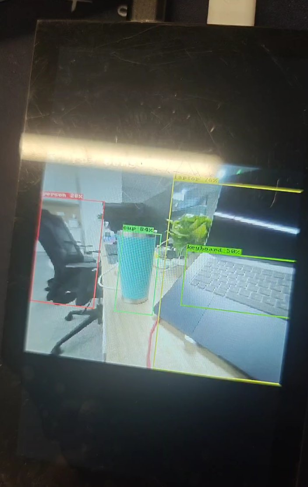
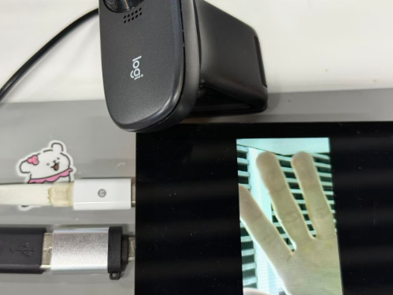
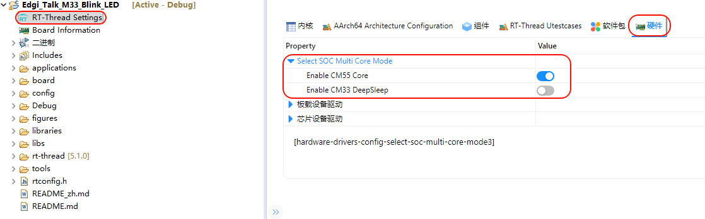

# Edgi_Talk_M55_RTAK RT-AK Deployment Project

[**中文**](./README_zh.md) | **English**

An M55 project for deploying models with RT-AK. It is a copy of `Edgi_Talk_M55_USB_UVC` and keeps the UVC camera and LCD. Differences from the original:

* LCD rotation is fixed at 0 degrees (`M55_BSP_LCD_ROTATION_0`); saving RT-Thread Settings no longer switches it to 90 degrees;
* C++ (`RT_USING_CPLUSPLUS`) and cache (`RT_USING_CACHE`) are on, selected by `RTAK_BSP` in the project `Kconfig`.

The linker script, drivers and application code are the same as the original project.

## Example model

The demo model for this project is **YOLOv8n object detection**:

| Item | Details |
| --- | --- |
| Model | Ultralytics `yolov8n.pt` pretrained weights, not retrained |
| Classes | 80 COCO classes (person, cup, laptop, keyboard, chair, ...) |
| Export | `yolo export model=yolov8n.pt format=litert imgsz=192` (or export ONNX) |
| Input | `[1, 3, 192, 192]`, RGB, letterbox resize |
| Output | `[1, 84, 756]`: 4 normalized box coordinates + 80 class scores, no NMS (NMS runs on the board) |
| Quantization and compilation | `rtak convert` quantizes it to full INT8 with 100–300 calibration images, then compiles it with Arm Vela |
| Runs on | Cortex-M55 + Ethos-U55 NPU; the model is in XIP flash and the inference arena in SOCMEM |

See `examples/yolov8/README.md` in the RT-AK repository for exporting the model and preparing calibration data.

## Demo

The USB camera image (320×240) is shown live on the LCD. Each frame is resized to 192×192 and run on the NPU; the board decodes the output, runs NMS and draws the results onto the image:

* every detected object gets a colored box labeled with the class name and confidence (for example `cup 84%`);
* the current frame rate is shown in the top-left corner of the LCD;
* each frame is shown after its own detection finishes, so the boxes line up with the image. If an object is missed in a frame, its box is kept for up to 3 more detections to reduce flicker.

A photo of an office desk, with `chair`, `cup`, `laptop` and `keyboard` detected at the same time. `4.9fps 86ms` in the top-left corner means about 4.9 detections per second, with an average of 86 ms per inference (NPU inference plus decoding and NMS):



Once per second the serial terminal prints the frame rate and a timing breakdown, followed by each box (class, confidence ×1000, coordinates):

```text
[yolov8] x.x fps, N ms/frame = prepare N + infer N + other N ms, boxes N-N
person 873/1000 [102,40,298,371]
```

`prepare` is resizing and quantization, `infer` is NPU inference plus decoding and NMS, and `other` is LCD display and waiting for the next camera frame.

See section 5 for the steps.

## 1. Get the project

Either:

* RT-Thread Studio: New project → Based on board → PSOC_E84-EDGI-TALK → example `Edgi_Talk_M55_RTAK`;
* Clone this repository, run `mklinks.bat` in this directory, then in Studio: File → Import → RT-Thread Studio Project into Workspace, and select this directory.

## 2. Deploy a model

In PowerShell at the RT-AK repository root (set `$bsp` to this project's directory):

```powershell
$bsp = 'C:\work\sdk-bsp-psoc_e84-edgi-talk\projects\Edgi_Talk_CherryUSB\Edgi_Talk_M55_RTAK'
rtak convert --model <model.tflite> --board edgi_talk_uvc_vendor --project "$bsp" --dataset <calibration data>
```

## 3. Build and download

1. In Studio, right-click the project → Refresh;
2. Open RT-Thread Settings and save without changing anything;
3. Build the project;
4. Download the M55 firmware only, then reset the board.

## 4. Check on the board

In a serial terminal (115200 8N1):

```text
msh />rtak_run
```

`[rtak] check=PASS` means the deployment works.

With a USB camera plugged in, run `usbh_uvc_start 0 320 240` (0 = YUYV, 1 = MJPEG; up to 432x240) to show the camera image on the LCD:



## 5. Camera object detection (YOLOv8n)

1. Prepare `yolov8n.tflite` and a calibration image folder `calib_images` as in sections 1 and 2 of `examples/yolov8/README.md` in the RT-AK repository.
2. Deploy:

   ```powershell
   rtak convert --model yolov8n.tflite --board edgi_talk_uvc_vendor --project "$bsp" --dataset calib_images
   ```

3. Copy `yolov8_app.c`, `yolov8_app.h` and `yolov8_uvc.c` from `examples/yolov8/` in the RT-AK repository to this project's `applications/`:

   ```powershell
   Copy-Item RT-AK/examples/yolov8/yolov8_app.c, RT-AK/examples/yolov8/yolov8_app.h, RT-AK/examples/yolov8/yolov8_uvc.c "$bsp\applications\"
   ```

4. Refresh, save RT-Thread Settings, build and download M55 only, as in section 3.
5. Plug in a USB camera and run in the serial terminal:

   ```text
   msh />usbh_uvc_start 0 320 240
   msh />yolov8_start
   ```

   The serial terminal prints the frame rate and timing once per second, and the LCD shows the boxes. Run `yolov8_stop` to stop.

## 6. Boot order

M55 is started by M33. If M55 does not run, build and download `Edgi_Talk_M33_Template` first and enable CM55 in the M33 project:

```
RT-Thread Settings -> Hardware -> select SOC Multi Core Mode -> Enable CM55 Core
```


