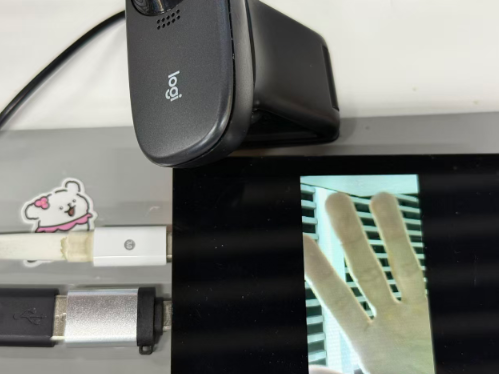
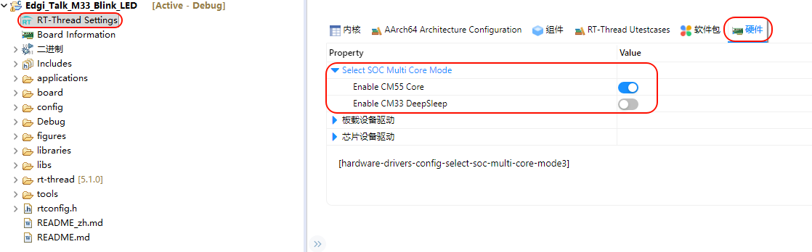

# Edgi_Talk_M55_RTAK RT-AK Deployment Project

[**中文**](./README_zh.md) | **English**

An M55 project for deploying models with RT-AK. It is a copy of `Edgi_Talk_M55_USB_UVC` and keeps the UVC camera and LCD. Differences from the original:

* LCD rotation is fixed at 0 degrees (`M55_BSP_LCD_ROTATION_0`); saving RT-Thread Settings no longer switches it to 90 degrees;
* C++ (`RT_USING_CPLUSPLUS`) and cache (`RT_USING_CACHE`) are on, selected by `RTAK_BSP` in the project `Kconfig`.

The linker script, drivers and application code are the same as the original project.

## 1. Get the project

Either:

* RT-Thread Studio: New project → Based on board → PSOC_E84-EDGI-TALK → example `Edgi_Talk_M55_RTAK`;
* Clone this repository, run `mklinks.bat` in this directory, then in Studio: File → Import → RT-Thread Studio Project into Workspace, and select this directory.

## 2. Deploy a model

In PowerShell at the RT-AK repository root (set `$bsp` to this project's directory):

```powershell
$bsp = 'C:\work\sdk-bsp-psoc_e84-edgi-talk\projects\Edgi_Talk_CherryUSB\Edgi_Talk_M55_RTAK'
rtak convert --model <model.tflite> --board edgi_talk_uvc_vendor --project "$bsp" --dataset <calibration data>
```

## 3. Build and download

1. In Studio, right-click the project → Refresh;
2. Open RT-Thread Settings and save without changing anything;
3. Build the project;
4. Download the M55 firmware only, then reset the board.

## 4. Check on the board

In a serial terminal (115200 8N1):

```text
msh />rtak_run
```

`[rtak] check=PASS` means the deployment works.

With a USB camera plugged in, run `usbh_uvc_start 0 320 240` (0 = YUYV, 1 = MJPEG; up to 432x240) to show the camera image on the LCD:



## 5. Boot order

M55 is started by M33. If M55 does not run, build and download `Edgi_Talk_M33_Template` first and enable CM55 in the M33 project:

```
RT-Thread Settings -> Hardware -> select SOC Multi Core Mode -> Enable CM55 Core
```


