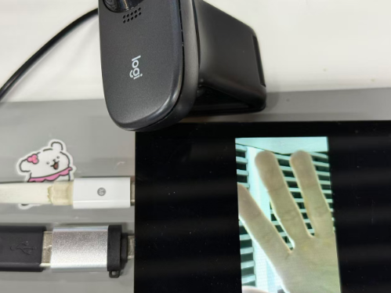
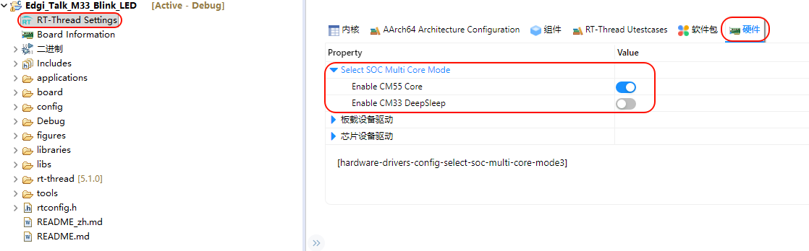

# Edgi_Talk_M55_RTAK RT-AK 部署工程

**中文** | [**English**](./README.md)

用于 RT-AK 部署模型的 M55 工程，由 `Edgi_Talk_M55_USB_UVC` 复制而来，保留 UVC 摄像头与 LCD。与原工程相比：

* LCD 旋转固定为 0 度（`M55_BSP_LCD_ROTATION_0`），在 RT-Thread Settings 中保存不会变为 90 度；
* 默认开启 C++（`RT_USING_CPLUSPLUS`）与 cache（`RT_USING_CACHE`），由工程 `Kconfig` 中的 `RTAK_BSP` 选中。

链接脚本、驱动和应用代码与原工程相同。

## 1. 获取工程

任选一种：

* RT-Thread Studio：新建工程 → 基于开发板 → PSOC_E84-EDGI-TALK → 示例 `Edgi_Talk_M55_RTAK`；
* 克隆本仓库，在本目录双击运行 `mklinks.bat`，然后在 Studio 中：文件 → 导入 → RT-Thread Studio 项目到工作空间，选择本目录。

## 2. 部署模型

在 RT-AK 仓库根目录的 PowerShell 中执行（`$bsp` 改为本工程的实际目录）：

```powershell
$bsp = 'C:\work\sdk-bsp-psoc_e84-edgi-talk\projects\Edgi_Talk_CherryUSB\Edgi_Talk_M55_RTAK'
rtak convert --model <模型.tflite> --board edgi_talk_uvc_vendor --project "$bsp" --dataset <校准数据>
```

## 3. 编译与下载

1. Studio 中右键工程 → 刷新；
2. 打开 RT-Thread Settings，不改任何选项，直接保存；
3. 构建工程；
4. 只下载 M55 固件，复位开发板。

## 4. 上板确认

串口终端（115200 8N1）执行：

```text
msh />rtak_run
```

输出 `[rtak] check=PASS` 即部署成功。

插入 USB 摄像头后执行 `usbh_uvc_start 0 320 240`（0 = YUYV，1 = MJPEG；最大 432x240），LCD 显示画面：



## 5. 启动顺序

M55 由 M33 启动。M55 无法运行时，先编译并下载 `Edgi_Talk_M33_Template`，并在 M33 工程中开启 CM55：

```
RT-Thread Settings -> 硬件 -> select SOC Multi Core Mode -> Enable CM55 Core
```


