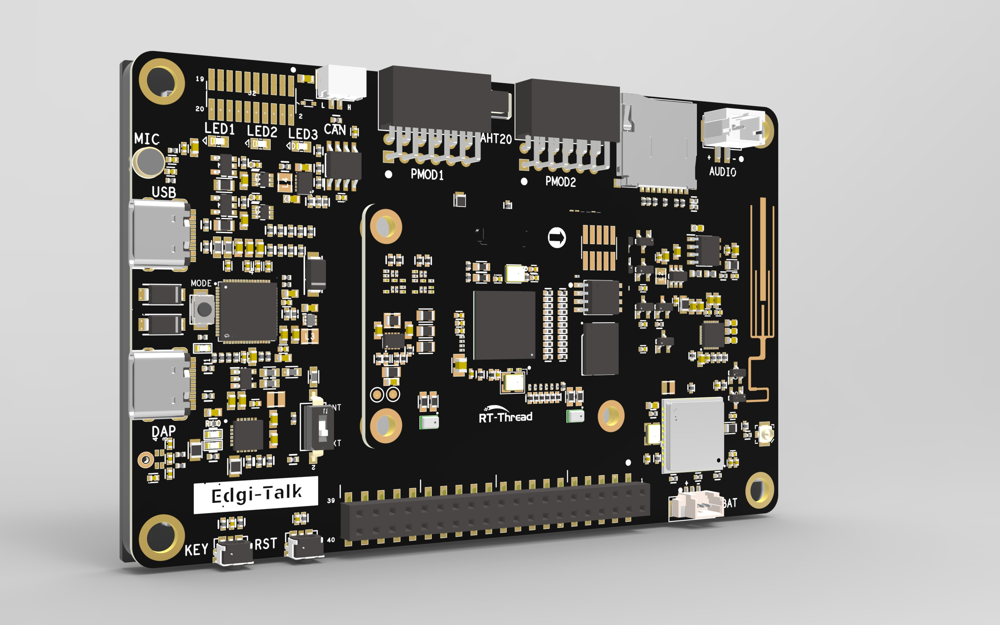

# Edgi_Talk_M55_BT_Speaker 示例工程

**中文** | [**English**](./README.md)

## 简介

本示例工程基于 **Edgi-Talk 平台**，运行在 **M55 核** 上，演示如何把开发板做成一个**蓝牙音箱**：

- 手机通过经典蓝牙 A2DP 把音乐推送到开发板；
- 开发板使用 **BlueKitchen BTstack** 完成经典蓝牙协议栈、A2DP Sink、AVRCP 和 SBC 解码；
- 解码后的 PCM 通过 RT-Thread `sound0` 音频设备送到 **ES8388 + I2S/TDM**，由板载扬声器播放；
- 支持手机端 AVRCP 音量调节（绝对音量）和播放/暂停按键。

> **许可证提醒**：RT-Thread `btstack` 软件包基于 BlueKitchen BTstack，**非商业用途免费**；商业产品需要向 BlueKitchen 购买授权。相关声明见 `packages/btstack-latest/LICENSE`。如果产品要商用，建议后续替换为 Infineon AIROC 官方蓝牙协议栈。



## 硬件说明

| 功能 | 硬件资源 |
| :--- | :--- |
| 蓝牙控制器 | 板载 **CYW55512** Wi-Fi + Bluetooth 组合芯片（55500A1 die），BT 通过 HCI UART 连接 |
| BT HCI UART | SCB4，RT-Thread 设备名 `uart4`，引脚 P10.0(RX) / P10.1(TX) / P10.2(CTS) / P10.3(RTS) |
| 音频输出 | ES8388 codec（I2C0，地址 0x10）+ I2S/TDM + 板载扬声器 |
| 功放使能 | `SPEAKER_OE_CTRL`（P21.6），由 `board.c` 的 `en_gpio()` 拉高 |
| 模块供电 | `WIFI_OE_CTRL` / `WIFI_WL_REG_OE_CTRL`，由 `board.c` 的 `en_gpio()` 拉高 |

蓝牙固件使用 Infineon `bt-fw-ifx-cyw55500a1`（release-v2.2.0，版本
`CYW55500A1_001.002.032.0145.0000_Generic_UART_47MHz`）的
`wlbga_iPA_sLNA_ANT0_LHL_XTAL_IN` 变体（与 BSP `bsp.mk` 的
`BSP_COMPONENTS` / `DEVICE_COMPONENTS` 一致），已内置在
`applications/bt_stack/btfw.c` 中，无需额外烧录固件分区。

## 软件说明

工程结构：

```
Edgi_Talk_M55_BT_Speaker
├── applications
│   ├── bt_speaker.c              // A2DP Sink + AVRCP 应用、MSH 命令
│   └── bt_stack
│       ├── btstack_config.h      // Classic-only BTstack 配置
│       ├── btstack_run_loop_rtt.c    // RT-Thread 运行循环
│       ├── btstack_uart_block_rtt.c  // uart4 HCI H4 传输
│       ├── btstack_audio_rtt.c       // sound0 音频 sink
│       ├── btfw.c                // CYW55500A1 固件
│       └── SConscript
├── board                         // 板级初始化（电源、ES8388、功放）
├── packages
│   └── btstack-latest            // 裁剪后的 BTstack 源码（Classic + A2DP + SBC）
├── figures
└── Kconfig / rtconfig.h / .config
```

关键实现：

- **BT 上电/下载时序**：P11.0（`BT_REG_ON`）先拉低，初始化 `uart4`（SCB4 在 RX FIFO
  为空时会拉低 RTS，即模块 CTS 为低），再把 `BT_REG_ON` 拉高，让 boot ROM 进入
  auto-baud 模式；随后 3 秒内发送第一条 HCI Reset。
- **UART**：固件下载阶段固定在 **115200**（CYW55512 的 boot ROM 在 minidriver 下载前
  不应答 `0xFC18` 改波特率命令）；补丁固件运行后，在 HCI `WORKING` 状态通过 `0xFC18`
  把控制器和主机切换到 **3 Mbps**（A2DP 码率需要）。127 KB 固件在 115200 下约需 11 秒。
- **音频**：A2DP 媒体包到达时立即解码 SBC 并重采样到 48 kHz，写入 8192 帧
  （约 170 ms）的 PCM FIFO；播放定时器使用**绝对截止时间**，避免 BTstack run loop
  的唤醒延迟逐周期累积；4 块环形缓冲吸收写线程抖动。`sound0` 配置为 48 kHz / 16 bit，
  `drv_i2s.c` 在 `BSP_USING_AUDIO_STEREO` 下直接接收交织立体声，不再做单声道复制。
- **I2S 时钟校准**：本板 TDM 的 48 kHz 分频使用 `7 + 0/32`（实测约 47.96 kHz），
  与 48 kHz 播放定时器偏差约 0.08%，由 PCM FIFO 的漂移控制吸收。
- **运行循环**：不使用 POSIX select/pthread，而是 RT-Thread 线程 + 信号量 + tick 的自定义
  `btstack_run_loop_t`，降低对 RT-Thread POSIX 配置的依赖。

## 使用方法

### 编译与下载

1. 使用 **RT-Thread Studio 2.2.9** 或以上版本打开/导入本工程（或直接在工程目录执行
   `scons`，工具链路径以 `rtconfig.py` 中的 ARM GNU 配置为准）。
2. 编译生成 `Debug/rtthread.hex`。
3. **先烧录 `Edgi_Talk_M33_Template`**（确保 M33 启动流程已使能 CM55），再烧录本工程的
   M55 镜像。
4. 复位开发板，串口终端应能看到：

   ```
   Edgi-Talk Bluetooth speaker example
   Phone pairing name: Edgi-Talk BT Speaker
   [bt] starting Bluetooth speaker
   [bt] firmware downloaded, starting HCI init
   [bt] stack up, local address xx:xx:xx:xx:xx:xx
   [bt] host UART switched to 3000000 baud
   ```

### 手机配对与播放

1. 打开手机蓝牙，搜索 **Edgi-Talk BT Speaker**。
2. 点击配对。设备无屏幕，使用 Just Works 自动确认；旧手机提示 PIN 码时输入 `0000`。
3. 配对成功后，用手机播放音乐，声音应从开发板扬声器输出。
4. 手机音量键通过 AVRCP 绝对音量控制 ES8388 输出音量。

### MSH 命令

```text
bt_speaker start          # 启动蓝牙音箱（main 已默认自动启动）
bt_speaker status         # 查看运行状态、A2DP/AVRCP 连接与播放状态
bt_speaker name <name>    # 修改蓝牙名称
bt_speaker stop           # 关闭蓝牙电源并退出协议栈线程（之后需重启开发板才能再次启动）
```

## 注意事项

- **BTstack 许可证**：非商业用途免费；商业用途需 BlueKitchen 授权。
- **蓝牙固件变体**：`btfw.c` 对应 `wlbga_iPA_sLNA_ANT0_LHL_XTAL_IN`。如果硬件版本不同，
  请从 `bt-fw-ifx-cyw55500a1` 选择匹配的 `btfw.c` 替换。
- **3 Mbps 切换**：boot ROM 阶段固定在 115200 下载固件；补丁固件运行后，协议栈进入
  WORKING 时通过 HCI `0xFC18` 把控制器和主机切到 3 Mbps。如果日志里没有
  `[bt] host UART switched to 3000000 baud`，请检查 `uart4` 流控和波特率配置。
- **M55 启动链**：M55 工程不含 M33 镜像，必须由 M33 Template（`SOC_Enable_CM55=y`）启动。
- 首次配对后链路密钥保存在内存中，复位后需要重新配对；如需掉电记忆可后续接入 TLV/Flash 存储。

## 启动流程

```
+------------------+
|   Secure M33     |
|   (安全内核启动)  |
+------------------+
          |
          v
+------------------+
|       M33        |
|   (非安全核启动)  |
+------------------+
          |
          v
+-------------------+
|       M55         |
|  (本示例应用启动)  |
+-------------------+
```

> 若示例无法运行，请先编译并烧录 **Edgi_Talk_M33_Template**，确认 CM55 已被启动。
